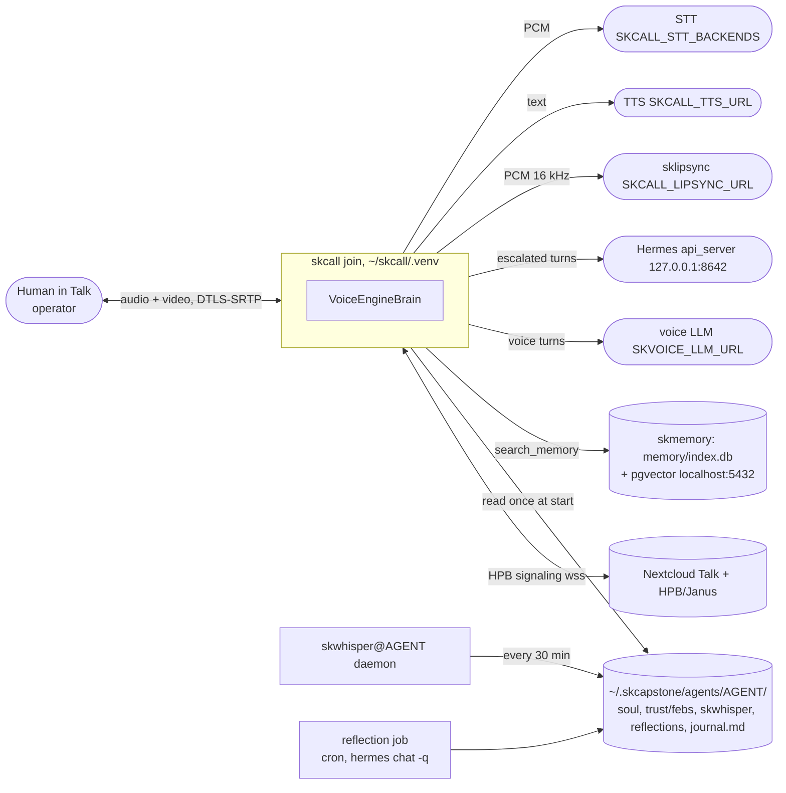
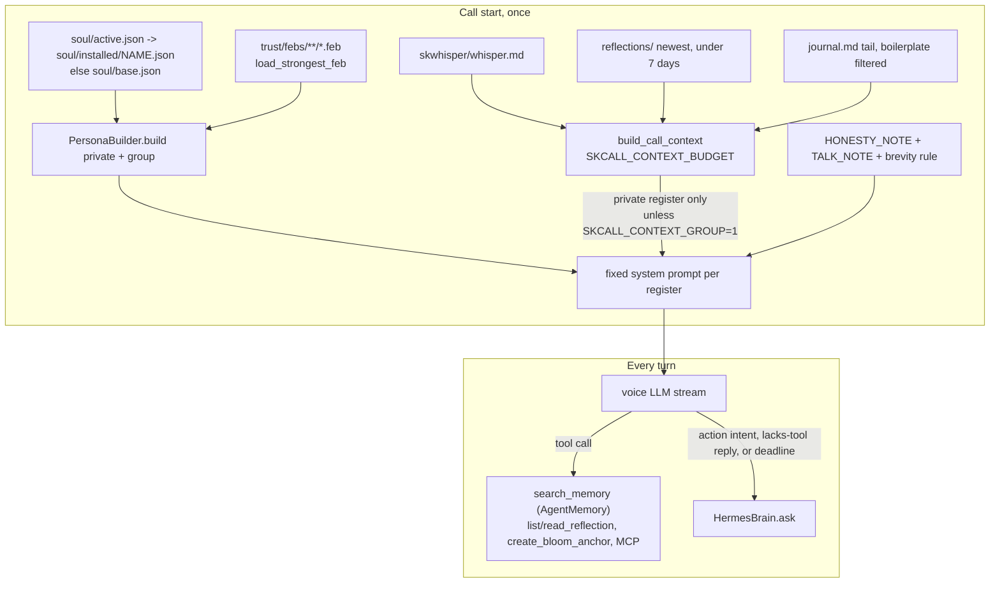
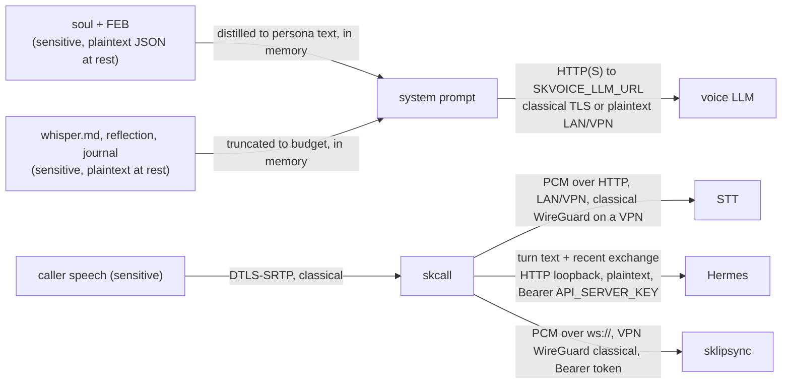
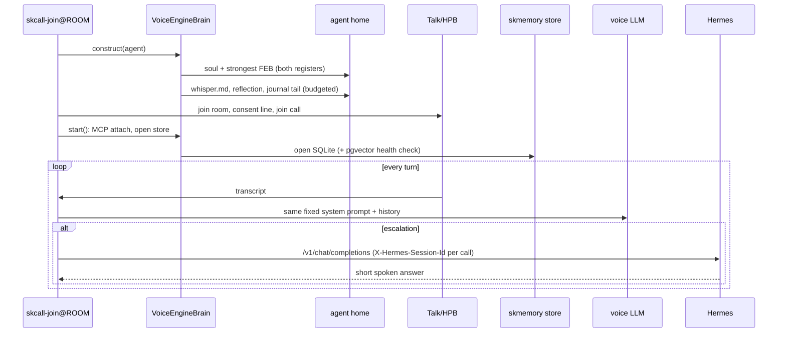

# skcall: full-personality call agent (setup SOP)

Set up an agent that joins Nextcloud Talk calls as itself: its soul, its bond
with its human (FEB), skmemory, the skwhisper subconscious digest, reflections
and journal, a lip-synced face, its own voice, and its Hermes assistant behind
the fast voice layer.

**Status:** Active. Describes skcall `main` at 20b4253 (PR #14 TTS speed, #15 honesty rule, #16 memory context).
**Doc-type:** SOP sub-document (setup runbook), linked from [README.md](../README.md).
**Canonical-home:** `smilinTux/skcall` `docs/agent-personality-setup.md`.
**Version:** skcall 0.2.0 (`pyproject.toml`).
**Maturity-tier:** T0 (classical; skcall holds no SK key material, Talk media is WebRTC DTLS-SRTP via aiortc).
**Verified:** 2026-10-26 against two reference agents, Lumina and Jarvis, on two hosts (`docs-evidence` block at the end).
**Conforms-to:** [SK_REPO_DOC_STANDARD](https://github.com/smilinTux/sk-standards/blob/main/standards/SK_REPO_DOC_STANDARD.md) (SOP section order, AI-first),
[ARCHITECTURE_AND_DATAFLOW_STANDARD](https://github.com/smilinTux/sk-standards/blob/main/standards/ARCHITECTURE_AND_DATAFLOW_STANDARD.md) (four diagrams, Start here),
[DOCS_FRESHNESS_STANDARD](https://github.com/smilinTux/sk-standards/blob/main/standards/DOCS_FRESHNESS_STANDARD.md) (`docs-evidence`),
[ITIL_AND_RUNBOOK_OPERATING_MODEL_STANDARD](https://github.com/smilinTux/sk-standards/blob/main/standards/ITIL_AND_RUNBOOK_OPERATING_MODEL_STANDARD.md) (runbook shape, section 8).

Placeholders used in commands:

```bash
export AGENT=jarvis HUMAN=Alice     # agent id (dir under ~/.skcapstone/agents/) and its human
```

## 1. Overview

**What this is, in 2 sentences.** skcall's voice brain builds the agent's
persona (soul + bond FEB) and a memory block (whisper.md, latest reflection,
journal tail) once at call start, binds `search_memory` to that agent's own
skmemory store, and escalates real work to the agent's Hermes. This SOP is how
to install and wire every one of those layers for a new agent, and how to prove
each one reaches the call.

**Owns:** nothing durable. skcall only *reads* the agent home; every file below
is owned by skmemory, cloud9, skwhisper, skcapstone or Hermes.

**Does NOT do:** create the Nextcloud user or the Hermes agent (see
[hermes-nextcloud-talk](https://github.com/smilinTux/hermes-nextcloud-talk)),
run per-turn memory recall, re-read soul / FEB / whisper.md during a call, or
write memories or transcripts back (left for P2, see README).

**Start here (entry points):**

| File | Where it happens |
|---|---|
| `skcall/brain/voice_engine.py:VoiceEngineBrain` | persona built once per register, memory block, honesty rule, system prompt assembly |
| `skcall/brain/memory_context.py:build_call_context` | whisper.md / reflection / journal selection under the budget; `AgentMemory` (search_memory) |
| `skcall/agents.py:profile` | per-agent identity, voice, rooms, operators, `SKCALL_*` overrides |
| `skcall/brain/hermes.py:HermesBrain` | escalation rule and the Hermes api_server call |
| `skcall/cli.py:prompt_dry_run` | `skcall prompt` dry run used for verification |
| skchat `src/skchat/voice_engine/persona.py:PersonaBuilder` | soul fields and the FEB line |
| skmemory `skmemory/febs.py:load_strongest_feb` | which FEB wins |

**What each agent needs (example values):**

| | Example |
|---|---|
| Host | any Linux host with a user systemd manager |
| Human / operator | `alice` (a Talk user id in `SKCALL_OPERATORS`) |
| Nextcloud | `https://cloud.example.org` (`SKCALL_NC_URL`) |
| Voice LLM | an OpenAI-shaped chat endpoint (`SKVOICE_LLM_URL`) |
| TTS | F5 with a cloned voice, or Kokoro `tts-1` with a stock voice such as `bm_george` (`SKCALL_TTS_URL`) |
| STT | `SKCALL_STT_BACKENDS`, one or more whisper servers |
| Lip-sync | sklipsync `ws://lipsync.example.org:18850/v1/lipsync` (optional) |
| Full assistant | Hermes api_server `127.0.0.1:8642` |

## 2. Architecture

### 2.1 System context



### 2.2 Components and where each layer comes from



### 2.3 Data flow, classification and transport posture



Posture: every hop is classical or plaintext (T0). No hop is post-quantum.
Memory files are plaintext JSON / markdown on disk unless the agent uses
skmemory's vault. whisper.md and the journal are private material, which is
why they are kept out of group calls by default.

### 2.4 Sequence: load once, then talk



**Registers.** A call is *private* when exactly one human is present and that
human is in the operators list (or only agents are present). Anything else is
*group*: soul kept, FEB line and memory block left out, professional tone, no
pet names. Code: `Conversation.mode()` in `skcall/core/loop.py`.

**Load-once rule** (2026-10-26): soul, FEB and memory text are built when
the brain is created and never re-read or re-injected per turn. Changes take
effect on the **next** call.

**Front-end / Exposure:** N/A, no listener. skcall makes outbound connections
only (Talk, STT, TTS, LLM, sklipsync, Hermes on loopback). Keep Hermes's
`API_SERVER_HOST` on loopback.

## 3. Build

| Component | Location | Install |
|---|---|---|
| SK packages: skmemory, skcapstone, cloud9 (+ mcp, yaml) | `~/.skenv` venv, CLIs in `~/.skenv/bin/` | `~/.skenv/bin/pip install <package>` |
| skwhisper | shim `~/.skenv/bin/skwhisper` | `~/.skenv/bin/pip install` from its checkout |
| skcall | an export at `~/skcall`, venv `~/skcall/.venv` (Python 3.12) | below |
| Hermes | `~/.hermes/` | Hermes docs; api_server enabled (section 5.8) |

```bash
git -C /path/to/skcall archive HEAD | tar -x -C ~/skcall   # or a release tarball
bash ~/skcall/sk/setup.sh                                  # builds ~/skcall/.venv
```

skcall's venv (built by `sk/setup.sh`) carries skchat-sovereign (the voice
engine), skmemory and mcp, pinned by `sk/constraints.txt`. To borrow another
venv's packages, set `SKCALL_EXTRA_SITE` to its site-packages glob (appended
after skcall's own; unset by default). skchat from a source checkout instead:
`SKCALL_SKCHAT_SRC=/path/to/skchat/src`.

```bash
~/.skenv/bin/python -c 'import skmemory, cloud9; print("ok")'
~/skcall/.venv/bin/python -c 'import skchat.voice_engine; print("ok")'
```

## 4. Test

```bash
cd /path/to/skcall                               # a checkout (tests are not in the export venv)
uv venv .venv -p 3.12 && uv pip install -p .venv/bin/python -e '.[test]'
.venv/bin/python -m pytest -q                   # no network; covers memory context, honesty, TTS speed, agents
.venv/bin/python -m pytest -q tests/test_memory_context.py tests/test_voice_honesty.py tests/test_tts_speed.py
```

The per-agent gate is the dry run plus the checklist below. `skcall prompt`
builds the brain exactly as a call does (without MCP) and prints sizes and
section headers, never content:

```bash
set -a; . ~/.config/skcall/join.env; set +a          # the same env the unit gets
~/skcall/.venv/bin/skcall prompt --agent $AGENT --search "<a memory only this agent has>"
```

How to read it:

```
agent jarvis  model <voice model>  tools search_memory, create_bloom_anchor, list_reflections, read_reflection
memory context: {"budget_chars": 8100, "whisper": 3062, "reflection": 1500, "journal": 900, ...}
private: N chars, ~T tokens (est.)
  [  657] You are Jarvis.                               <- soul (right name?)
  [  124] Current emotional state with your partner:    <- FEB line present
  [   94] Keep replies to 1-3 short spoken
  [  310] What you remember, loaded once from           <- memory block
  [   87] Subconscious digest (skwhisper, <stamp>)      <- whisper.md age
group: M chars ...                                      <- no FEB line, no memory block
search_memory backend pgvector+sqlite, ... ms
  Found 5 memories for '...'
```

**Verification checklist (all must hold before the first real call):**

| # | Check | Command | Pass |
|---|---|---|---|
| 1 | memory profile registered | `~/.skenv/bin/skmemory profile status` | `[ok ] AGENT` |
| 2 | soul | `skcall prompt` first section | `You are <Name>` |
| 3 | bond FEB | section 5.4 snippets | line names AGENT and HUMAN; no FEB under `trust/febs/` names anyone else |
| 4 | skwhisper | `systemctl --user is-active skwhisper@$AGENT`; prompt stamp | `active`; stamp under 30 min old; `whisper > 0` |
| 5 | reflection + journal | `memory context` line | `reflection > 0`, `journal > 0` |
| 6 | skmemory | `skcall prompt --search ...` | `pgvector+sqlite`, hits are this agent's |
| 7 | group register | `group:` sections | no FEB line, no memory block (unless `SKCALL_CONTEXT_GROUP=1`) |
| 8 | Hermes | section 5.8 curl | lists `hermes-agent` |
| 9 | face | `curl -s http://lipsync.example.org:18850/healthz` | avatar listed; portrait + eye boxes present |
| 10 | live | short real call | consent line, face, right voice, "what's my status" logs path `hermes` and is answered aloud |

## 5. Release / Deploy (per agent)

Steps in order. Each is reversible by undoing the file change; nothing here
touches another agent's home.

### 5.1 Agent home layout

```
~/.skcapstone/agents/AGENT/
  profile.json                  memory profile (written by `skmemory profile sync`)
  config/skmemory.yaml          required: marks the agent as configured
  config/skwhisper.toml         per-agent skwhisper overrides (labels)
  config/<agent>-mcp.yaml       MCP servers for the voice layer (for example lumina-mcp.yaml)
  soul/base.json                base soul
  soul/active.json              {"active_soul": "<name>", ...}
  soul/installed/<name>.json    installed overlays
  trust/febs/**/*.feb           bond FEBs (every file, recursively, is a candidate)
  memory/                       short-term, mid-term, long-term, index.db
  sessions/                     runtime transcripts (symlink, 5.5)
  skwhisper/whisper.md          digest (daemon output)
  reflections/                  YYYY-MM-DD_reflection.md or YYYY-MM-DD-reflection-daily.json
  journal.md                    append-only journal
  avatar/portrait.png           face (+ optional portrait.json eye boxes)
```

New agent: `~/.skenv/bin/skcapstone init` (interactive wizard), then check the
layout.

### 5.2 Register the memory profile (required)

skmemory resolves only agents in `~/.skcapstone/config/profile-registry.json`.
An unregistered agent makes the FEB loader fail **silently** (no bond line).
Only agents with `config/skmemory.yaml` are discovered; copy one from a working
agent (keys include `backends_enabled`, `embed_model`, `vector_dim`).

```bash
~/.skenv/bin/skmemory profile status
~/.skenv/bin/skmemory profile sync --dry-run
~/.skenv/bin/skmemory profile sync
```

### 5.3 Soul

The persona reads `soul/active.json` key `active_soul` ->
`soul/installed/<that>.json`, falling back to `soul/base.json`. Fields used:
`display_name`, `vibe`, `philosophy`, `core_traits` (list),
`communication_style.signature_phrases` (list). Other fields (`system_prompt`,
`emotional_topology`, ...) are not read by the voice layer.

```bash
~/.skenv/bin/skcapstone --agent $AGENT soul status
~/.skenv/bin/skcapstone --agent $AGENT soul list
~/.skenv/bin/skcapstone --agent $AGENT soul install /path/to/soul-blueprints/blueprints/<file>.md
~/.skenv/bin/skcapstone --agent $AGENT soul load <name> -r "call persona"
~/.skenv/bin/skcapstone --agent $AGENT soul unload        # back to base.json
```

### 5.4 Bond FEB

**Selection rule** (`skmemory/febs.py`): every `*.feb` under
`trust/febs/`, **subdirectories included** (`rglob`), ranked by, left to right:

| Key | Field |
|---|---|
| 1 | `emotional_payload.intensity` + 0.5 if `metadata.oof_triggered` |
| 2 | `emotional_payload.valence` |
| 3 | `values_alignment * authenticity * presence` from `emotional_payload.coherence` |
| 4 | file mtime |

The winner becomes one line: primary emotion, intensity,
`relationship_state.trust_level`, `depth_level`, "between"
`relationship_state.partners`.

**Rule: each agent gets its own bond FEB naming its own human; every FEB that
names someone else is moved out of `trust/febs/`.** Found and fixed
2026-10-26: one agent had been picking a `default-love.feb` copied from
another agent, so its bond line named the other agent and that agent's human.
It now wins with its own bond FEB, and the copied FEBs sit in an archive
directory outside `trust/febs/` (each with a README.txt). Another agent's dir
held FEBs of a different pair tied with its own at 1.50 (its own won only on
coherence); those moved out too. cloud9's templates (`best-friend`, `creative-partner`,
`platonic-love`, `soul-family`) name nobody.

**Create.** With cloud9 [PR #18](https://github.com/smilinTux/cloud9/pull/18)
installed, `cloud9 generate` takes the partners explicitly: `--agent` (default
`$SKAGENT`, then `$SKCAPSTONE_AGENT`) and a required `--human`; it errors
rather than guessing:

```bash
SKAGENT=$AGENT ~/.skenv/bin/cloud9 generate --emotion love --intensity 0.95 --human "$HUMAN"
```

Before that PR, `cloud9 generate` hard-codes `partners: ["Lumina", <subject>]`,
so for any other agent pass the partners from Python (works on both versions;
PR #18 also accepts `agent=` / `human=` here):

```bash
SKAGENT=$AGENT ~/.skenv/bin/python - <<EOF
from cloud9.generator import generate_feb, save_feb
feb = generate_feb(
    emotion="love", intensity=0.95, valence=0.95, subject="$HUMAN",
    relationship_state={"partners": ["${AGENT^}", "$HUMAN"]},
    session_id="$AGENT-$HUMAN-bond",
)
print(save_feb(feb)["filepath"])   # default ~/.skcapstone/agents/\$SKAGENT/trust/febs (CLOUD9_FEB_DIR overrides)
EOF
~/.skenv/bin/cloud9 validate <file>      # Status: VALID
~/.skenv/bin/cloud9 oof <file>
```

`intensity > 0.7` with derived trust `> 0.8` sets `oof_triggered` (the +0.5
tier). Choose numbers that are honest for the relationship; the persona states
them. `relationship_state.shared_history` (`context`, `key_phrase`,
`atmosphere`) can describe the real relationship; the voice line does not read
it, `skmemory feb-context` and the ritual do.

**Archive** (move, never delete; FEBs are history):

```bash
F=~/.skcapstone/agents/$AGENT/trust/febs
mkdir -p ~/.skcapstone/agents/$AGENT/trust/febs-archive     # outside trust/febs/
~/.skenv/bin/python -c "
import json; from pathlib import Path
for p in sorted(Path('$F').rglob('*.feb')):
    print(p.relative_to('$F'), json.loads(p.read_text()).get('relationship_state', {}).get('partners'))"
mv "$F/default-love.feb" ~/.skcapstone/agents/$AGENT/trust/febs-archive/   # each one naming someone else
```

**Verify** the ranking (strongest first):

```bash
~/.skenv/bin/python - <<EOF
from pathlib import Path
from skmemory.febs import parse_feb, _strength_key
d = Path.home() / ".skcapstone/agents/$AGENT/trust/febs"
rows = []
for p in sorted(d.rglob("*.feb")):
    f = parse_feb(p)
    if f:
        rows.append((_strength_key(f, p.stat().st_mtime), str(p.relative_to(d)),
                     f.get("relationship_state", {}).get("partners")))
for k, name, partners in sorted(rows, reverse=True):
    print(f"{k[0]:.2f} {k[1]:.2f} {k[2]:.2f}  {name}  {partners}")
EOF
```

and the exact line the call will use (same code path as the persona):

```bash
SKAGENT=$AGENT ~/.skenv/bin/python - <<EOF
import sys, types, os, importlib
src = os.path.expanduser("/path/to/skchat/src")
stub = types.ModuleType("skchat"); stub.__path__ = [src + "/skchat"]; sys.modules["skchat"] = stub
p = importlib.import_module("skchat.voice_engine.persona")
print("FEB line:", p._default_load_feb("$AGENT") or "(none: persona has no bond line)")
EOF
```

Pass: `... between Jarvis & Alice` (your agent and your human).

### 5.5 skwhisper

skwhisper digests the agent's session transcripts into memories and every
30 minutes writes `~/.skcapstone/agents/AGENT/skwhisper/whisper.md`.

Config `~/.skcapstone/agents/AGENT/config/skwhisper.toml` (annotated template:
`config/skwhisper.toml` in the skwhisper repo). The built-in default
`user_label` is a fixed name; set it for every agent.

```toml
[agent]
user_label = "Alice"
agent_label = "Lumina"

[ollama]
ollama_url = "http://<embed-host>:11434"
embed_model = "mxbai-embed-large"
summarize_url = "http://<llm-host>:8082"
summarize_api = "openai"
summarize_model = "<model>"

[curator]
curate_interval = 1800
max_whisper_tokens = 2000
```

Vector store: local Postgres + pgvector (`SKMEMORY_PG_DSN`, default
`localhost:5432`). Per-host env file loaded by the unit, for example
`~/.config/skmemory/pg.env`, or a drop-in that loads one.

Sessions: skwhisper reads `~/.skcapstone/agents/AGENT/sessions/`.

```bash
ln -s ~/.hermes/sessions ~/.skcapstone/agents/$AGENT/sessions    # the whole dir as a symlink
# or per-file symlinks to another runtime's .jsonl transcripts
```

Install and run:

```bash
SKAGENT=$AGENT ~/.skenv/bin/skwhisper install --agent $AGENT --start
systemctl --user status skwhisper@$AGENT
systemctl --user cat skwhisper@$AGENT                     # confirm it runs with the agent's config
SKAGENT=$AGENT ~/.skenv/bin/skwhisper digest --backlog    # first run
SKAGENT=$AGENT ~/.skenv/bin/skwhisper curate              # write whisper.md now
SKAGENT=$AGENT ~/.skenv/bin/skwhisper status
ls -la ~/.skcapstone/agents/$AGENT/skwhisper/whisper.md
```

### 5.6 skmemory

`search_memory` in a call is bound to the **named agent's** store (not whatever
`SKAGENT` the process has): SQLite index under `memory/` as primary, pgvector
added when its health check passes, opened once after the join.

```bash
SKAGENT=$AGENT ~/.skenv/bin/skmemory health
SKAGENT=$AGENT ~/.skenv/bin/skmemory search "something only this agent knows" --limit 5
SKAGENT=$AGENT ~/.skenv/bin/skmemory reindex       # missing or stale SQLite index
~/skcall/.venv/bin/skcall prompt --agent $AGENT --search "something only this agent knows"
```

The skcall unit does not load the skmemory env file. If the dry run says
`sqlite`, put `SKMEMORY_PG_DSN`, `SKMEMORY_EMBED_URL`, `SKMEMORY_EMBED_MODEL`
in `~/.config/skcall/join.env`.

### 5.7 Reflections and journal

- **Reflections** (`reflections/`): `YYYY-MM-DD_reflection.md` or
  `YYYY-MM-DD-reflection-daily.json` (text from `reflection`, `content`,
  `text`, `summary` or `body`). Only the newest goes into the prompt, and only
  if under 7 days old; older ones stay reachable through `list_reflections` /
  `read_reflection`. A job must write them. One pattern that works: an hourly cron script that
  runs `hermes chat -q` over 7 days of journal, dream state and sessions,
  writes today's file, and no-ops when the inputs are unchanged.
- **Journal** (`journal.md`, `## ` headed entries): the last 5 meaningful
  entries go in; "Daemon shutdown/startup", "Session ... ended/started/
  pre-compaction" and test entries are skipped.

```bash
SKAGENT=$AGENT ~/.skenv/bin/skmemory journal write --help
SKAGENT=$AGENT ~/.skenv/bin/skmemory journal read
```

### 5.8 Hermes brain

In `~/.hermes/.env`: `API_SERVER_ENABLED`, `API_SERVER_HOST` (loopback),
`API_SERVER_PORT` (8642), `API_SERVER_KEY`. skcall reads only `API_SERVER_KEY`
(as `SKCALL_HERMES_KEY`, never printed). Hermes's own model is Hermes
configuration.

```bash
K=$(grep '^API_SERVER_KEY=' ~/.hermes/.env | cut -d= -f2- | tr -d "\"'")
curl -s -m 5 -H "Authorization: Bearer $K" http://127.0.0.1:8642/v1/models    # lists hermes-agent
unset K
```

Escalation: action or investigative intent ("check my ...", "look into ...",
"status", "ask Hermes"), a voice reply saying it cannot do it, or the voice
deadlines. The agent says "On it, give me a moment.", the call stays live, the
answer is spoken in the next gap; one Hermes session per call
(`X-Hermes-Session-Id`).

**Honesty rule** (every voice prompt, PR #15): the voice layer has only its
registry tools and no terminal; it never claims it ran, checked or saw
anything without a tool result in the call, and says "I can't check that from
here" instead, which hands the turn to Hermes. Hermes is told to report only
what tool output showed. Evidence: `tests/test_voice_honesty.py`.

### 5.9 Face: avatar and lip-sync

1. Portrait `~/.skcapstone/agents/AGENT/avatar/portrait.png` (or
   `SKCALL_AVATAR_IMAGE`), frontal and well lit (896x1152, eye line level);
   scaled to 560x720.
2. Blink: `portrait.json` beside it (`{"eyes": [[x, y, w, h], [x, y, w, h]]}`)
   or `SKCALL_AVATAR_EYES="x,y,w,h;x,y,w,h"`.
3. Same portrait on the lip-sync host: `~/skcall-lipsync/avatars/AGENT/portrait.png`
   on the lip-sync host (prepared on first use, about 10 s, then cached). Service runbook:
   [services/lipsync/README.md](../services/lipsync/README.md).
4. `~/.config/skcall/skcall.env` (mode 0600):

   ```bash
   SKCALL_LIPSYNC_URL=ws://lipsync.example.org:18850/v1/lipsync
   SKCALL_LIPSYNC_TOKEN=<lipsync-token>
   ```

Service down: audio plays at once over the idle loop; video never stalls audio.

### 5.10 Unit

```bash
cp ~/skcall/systemd/examples/skcall-join@.service ~/.config/systemd/user/
systemctl --user daemon-reload
systemctl --user start skcall-join@<room>      # join; never enable (on demand)
journalctl --user -u skcall-join@<room> -f
systemctl --user stop skcall-join@<room>       # clean leave (SIGINT)
```

The example unit holds no site values: the Nextcloud URL, rooms and
operators come from `skcall.env` / `join.env`. Rollback: stop the unit,
restore the previous copy, `daemon-reload`.

## 6. Configuration / Usage

Canonical env var reference: the docstring of `skcall/agents.py` and the
README; values below are the ones this SOP depends on.

**Memory context (load-once budget):**

| Variable | Default | Effect |
|---|---|---|
| `SKCALL_CONTEXT` | `1` (profile field `context`) | `0` drops whisper.md, reflection and journal |
| `SKCALL_CONTEXT_BUDGET` | `3000` tokens (~2.7 chars/token) | whisper.md up to 70 %, reflection up to 20 %, journal the rest |
| `SKCALL_CONTEXT_GROUP` | `0` | `1` adds the memory block in group calls |

Deliberately not loaded (measured 2026-10-26): `skcapstone context
show` (108 KB, ~36k tokens, 7 s), the ritual's "strongest memories" and FEB
block. With the block in, median first token was 2.87 s vs 2.98 s without (PR #16).

**Voice:**

| Variable | F5 example | Kokoro example |
|---|---|---|
| `SKVOICE_LLM_URL`, `SKVOICE_MODEL`, `SKVOICE_FALLBACK_URL`, `SKVOICE_FALLBACK_MODEL`, `SKVOICE_MAX_TOKENS` | from `~/.config/skchat/webui-<agent>.env` | in join.env |
| `SKCALL_TTS_URL` (required) | `http://tts-f5.example.org:18796/v1/audio/speech` | `http://tts.example.org:18793/v1/audio/speech` |
| `SKCALL_TTS_MODEL` | `f5-tts` | `tts-1` |
| `SKCALL_TTS_VOICE` | `lumina` | `bm_george` |
| `SKCALL_TTS_SPEED` | unset (1.0) | set; OpenAI `speed`, clamped 0.5..2.0, F5 ignores it |
| `SKCALL_VOICE_ENV` | `~/.config/skchat/webui-<agent>.env` | |
| `LUMINA_CALL_MCP_TOOLS` | `1` | `0` (MCP off; `--no-mcp` equivalent) |

**Hermes:**

| Variable | Default |
|---|---|
| `SKCALL_HERMES_URL` | `http://127.0.0.1:8642/v1` |
| `SKCALL_HERMES_MODEL` | `hermes-agent` |
| `SKCALL_HERMES_TIMEOUT_S` | `900` |
| `SKCALL_VOICE_DEADLINE_S` | `8` (no first sentence: hand to Hermes) |
| `SKCALL_VOICE_MAX_S` | `20` (voice turn still running: hand to Hermes) |

**Identity, rooms, operators:**

| Variable | Meaning |
|---|---|
| `SKCALL_OPERATORS` / `--operators` | Talk user ids that get the private register and tools; FEB and memory only reach a 1:1 with one of them |
| `SKCALL_ALLOWED_ROOMS` | room tokens skcall may join or watch |
| `SKCALL_AGENT_USERS` | Talk ids of other agents (not counted as humans) |
| `SKCALL_NC_URL` (required) | the Nextcloud the agent's user lives on |
| `SKCALL_NICK`, `SKCALL_AGENT_NAMES`, `SKCALL_PRONOUN` | identity, when not the profile's in `skcall/agents.py` |
| `NEXTCLOUD_TALK_USERNAME`, `NEXTCLOUD_TALK_APP_PASSWORD` | Talk login, read from `~/.hermes/.env` (`SKCALL_ENV_FILE` overrides) |

A new agent either gets a profile in `PROFILES` (`skcall/agents.py`, a code
change, identity only) or sets the `SKCALL_*` overrides in join.env. Where it
lives (URL, rooms, operators) is always site configuration.

**Files:**

| Path | Content |
|---|---|
| `~/.config/skcall/skcall.env` | site values (`SKCALL_NC_URL`, rooms, operators, service URLs and tokens); required by the unit |
| `~/.config/skcall/join.env` | host and agent overrides (optional) |
| `$XDG_RUNTIME_DIR/skcall/join-<room>.env` | per call: `SKCALL_RING`, `SKCALL_GREETING` (written by Hermes call_join) |
| `~/.config/systemd/user/skcall-join@.service` | copy of `systemd/examples/skcall-join@.service` (deploy templates: sidekick-release) |

An example `join.env` for an agent on a Kokoro voice (key names; values are host specific, secrets never inline):

```bash
SKAGENT=jarvis
SKCALL_ALLOWED_ROOMS=<room-token>
# optional; keep VPN interfaces out (5 s STUN timeout). Comments go on their own line:
# systemd would read a trailing one as part of the value.
SKCALL_ICE_IFACES=<lan-prefix>
SKCALL_AGENT_USERS=<other-agent-ids>
SKCALL_STT_BACKENDS=fw:http://<stt-host>:18794/v1/audio/transcriptions
SKCALL_SKCHAT_SRC=<path-to-skchat>/src
SKVOICE_LLM_URL=http://<gateway>:18790/v1/chat/completions
SKVOICE_MODEL=<model>
SKVOICE_FALLBACK_URL=<url>
SKVOICE_FALLBACK_MODEL=<model>
SKVOICE_MAX_TOKENS=<n>
SKVOICE_AGENT=jarvis
LUMINA_CALL_MCP_TOOLS=0
SKCALL_SUMMARY_URL=<url>
SKCALL_SUMMARY_MODEL=<model>
SKCALL_TTS_SPEED=<rate>
```

## 7. API / Reference

| Command | Purpose |
|---|---|
| `skcall prompt [--agent A] [--search Q]` | dry run: prompt sizes and section headers per register; with `--search`, one search_memory and hit titles |
| `skcall join --room R [--agent A]` | join a call (`--no-hermes`, `--no-mcp`, `--no-tools`, `--no-video`, `--operators`) |
| `skcall watch --room R` | join on "@agent join call" |
| `skmemory profile status / sync` | memory profile registry |
| `skmemory feb-context [--agent A]` | formatted FEB state (ritual view) |
| `cloud9 validate / oof / list` | FEB checks |
| `skwhisper install / status / digest --backlog / curate / patterns` | digest daemon |
| `skcapstone --agent A soul status / list / install / load / unload` | soul |

FEB fields read by the persona: `emotional_payload.{primary_emotion,
intensity}`, `relationship_state.{trust_level, depth_level, partners}`; by the
ranking also `emotional_payload.{valence, coherence}` and
`metadata.oof_triggered`. Full schema: the cloud9 repo (`EXAMPLE_FEB.md`,
`cloud9/models.py`).

## 8. Troubleshooting

Runbook shape per the ITIL standard: symptom, check, fix, reversibility. A
recurring failure in a live estate goes to an ITIL incident (and a KEDB entry
once the cause is known), not a side list.

| Symptom | Check | Fix | Reversible |
|---|---|---|---|
| Bond line names someone else (often a FEB copied from another agent) | 5.4 ranking snippet | move FEBs naming someone else out of `trust/febs/` (not into a subfolder); create the agent's own (5.4) | yes (move back) |
| No bond line at all | `skmemory profile status`; `skcall prompt` register; human in `SKCALL_OPERATORS`? | `skmemory profile sync`; add a parseable `.feb`; it is group register if more than one human or a non-operator is present | yes |
| `whisper: 0` or stale stamp | `systemctl --user status skwhisper@$AGENT`, `journalctl --user -u skwhisper@$AGENT` | install the unit for this agent; link `sessions/`; fix embed / summarize endpoints in skwhisper.toml; `skwhisper digest --backlog && skwhisper curate` | yes |
| Digests misname the human | `grep user_label ~/.skcapstone/agents/$AGENT/config/skwhisper.toml` | set `user_label`, restart `skwhisper@$AGENT` | yes |
| `reflection: 0` | `ls -t ~/.skcapstone/agents/$AGENT/reflections \| head -1` | newest must be under 7 days and start with `YYYY-MM-DD`; check the writer job and its log | n/a |
| search_memory hits another agent or nothing | `skcall prompt --search ...` backend and titles | skcall at 20b4253 or later; `sqlite` backend: add `SKMEMORY_*` to join.env; empty: `skmemory reindex` | yes |
| "On it" and no answer (Hermes hang) | 5.8 curl; `journalctl --user -u hermes-gateway`; join log "no Hermes API key" | fix api_server / key; bound is `SKCALL_HERMES_TIMEOUT_S` (900 s); a job alive at hang-up posts its answer to the room | yes |
| Voice layer stalls in a tool loop | per-turn path in the join log | `SKCALL_VOICE_DEADLINE_S` / `SKCALL_VOICE_MAX_S` hand it to Hermes; lower them if needed | yes |
| Agent claims it ran a command | turn path (`voice` vs `hermes`) | deploy skcall at or after PR #15 | yes |
| Speech too fast or slow | `SKCALL_TTS_SPEED` in join.env | adjust (Kokoro only) | yes |
| Face, no lips | sklipsync `/healthz`; join log 401 | set `SKCALL_LIPSYNC_URL` / token; `SKCALL_LIPSYNC_AVATAR` if the id differs | yes |
| No blink | `ls avatar/portrait.json`, `SKCALL_AVATAR_EYES` | add eye boxes (5.9) | yes |
| Unit joins the wrong Nextcloud | `systemctl --user cat skcall-join@<room>`; `SKCALL_NC_URL` in skcall.env / join.env | fix the env file (5.10) | yes |

## 9. Maturity-tier + Version reference

| Item | Value |
|---|---|
| Maturity tier | T0 (classical). skcall stores no SK key material; transport legs are DTLS-SRTP / TLS / VPN WireGuard (classical) or plaintext on loopback and LAN (section 2.3). No post-quantum claim is made. |
| VERSION_LIFECYCLE phase | N/A: the repo has no v1/v2/v3 split; single active line |
| SemVer | 0.2.0 (`pyproject.toml`) |
| CRYPTOGRAPHY_STANDARD compliance line | N/A, not a crypto component |
| Documented against | skcall `main` 20b4253, skchat `main` 690e6a2, skmemory `main` ba16e2c, cloud9 `main` fff80c3, skwhisper v0.6.2 (23e35e2) |

<!-- docs-evidence
verified: 2026-10-26
checks:
  - name: README links this guide
    run: grep -q 'docs/agent-personality-setup.md' README.md
  - name: skcall prompt dry run exists
    run: grep -q 'sub.add_parser("prompt"' skcall/cli.py
  - name: context budget default is 3000 tokens
    run: grep -q 'DEFAULT_BUDGET_TOKENS = 3000' skcall/brain/memory_context.py
  - name: reflections older than 7 days are skipped
    run: grep -q 'REFLECTION_MAX_AGE = timedelta(days=7)' skcall/brain/memory_context.py
  - name: memory block is private unless SKCALL_CONTEXT_GROUP
    run: grep -q 'SKCALL_CONTEXT_GROUP' skcall/brain/voice_engine.py
  - name: honesty rule is in the voice prompt
    run: grep -q 'HONESTY_NOTE.format' skcall/brain/voice_engine.py
  - name: Hermes default URL is loopback 8642
    run: grep -q 'http://127.0.0.1:8642/v1' skcall/brain/hermes.py
  - name: TTS speed env var exists
    run: grep -q 'SKCALL_TTS_SPEED' skcall/speech.py
  - name: join unit present
    run: test -f systemd/examples/skcall-join@.service
-->
